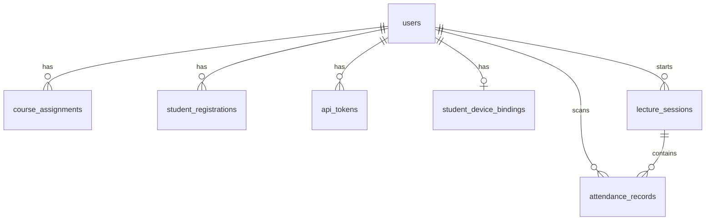

# UniAttend Backend Database Schema

Last reviewed: 2026-05-11

This document describes the Laravel backend schema used by UniAttend. It is written as an implementation reference for developers who need to understand table ownership, relationships, constraints, and the data lifecycle behind authentication, user management, device binding, lecture sessions, and attendance scans.

## Schema Overview

The backend uses users as the central identity table. Admins, staff/doctors, and students are all stored in `users` and separated by the `role` column.

Core domains:

- Identity and authorization: `users`, `api_tokens`
- Staff teaching assignments: `course_assignments`
- Student enrollment: `student_registrations`
- Student device lock: `student_device_bindings`
- Attendance runtime: `lecture_sessions`, `attendance_records`
- Laravel framework tables: `password_reset_tokens`, `sessions`, cache, and jobs tables

## Relationship Summary

```text
users
  1 -> many course_assignments       (staff/doctor course ownership)
  1 -> many student_registrations    (student subject enrollment)
  1 -> many api_tokens               (frontend API sessions)
  1 -> one  student_device_bindings  (student device lock)
  1 -> many lecture_sessions         (staff/admin started sessions)
  1 -> many attendance_records       (student attendance scans)

lecture_sessions
  1 -> many attendance_records
```

## Entity Relationship Diagram



## Tables

### users

Primary table for all application accounts.

| Column | Type | Null | Key / Index | Notes |
| --- | --- | --- | --- | --- |
| `id` | string | no | primary | String IDs such as `admin-1`, `staff-1`, `student-1`, or generated IDs. |
| `name` | string | yes | | Short/display name. |
| `full_name` | string | no | | Canonical full name. |
| `email` | string | no | unique | Login identifier for admin/staff; students can also login by student/national identifiers. |
| `email_verified_at` | timestamp | yes | | Laravel-compatible verification field. |
| `password` | string | no | | Hashed by the `User` model cast. Legacy plain text is upgraded on successful login. |
| `role` | string(40) | no | index | Canonical roles: `admin`, `staff`, `student`. `doctor` is normalized to `staff`. |
| `specialty` | string | yes | | Staff specialty or admin title. |
| `avatar` | string(20) | yes | | Initials or small avatar code. |
| `is_system` | boolean | no | | Protects seeded system admin from update/delete. |
| `permissions` | json | yes | | Frontend/backend permission array. |
| `allowed_colleges` | json | yes | | College scope for limited admins/staff. Empty means all colleges. |
| `student_id` | string | yes | index | Student academic identifier. |
| `university_id` | string | yes | index | University identifier; commonly mirrors `student_id`. |
| `national_id` | string | yes | index | Student national ID. |
| `college` | string | yes | index | Student college name/scope field. |
| `remember_token` | string | yes | | Laravel default. |
| `created_at` | timestamp | yes | | Laravel timestamp. |
| `updated_at` | timestamp | yes | | Laravel timestamp. |

Model:

- `App\Models\User`

Important casts:

- `password => hashed`
- `is_system => boolean`
- `permissions => array`
- `allowed_colleges => array`

Relationships:

- `courses()` -> `hasMany(CourseAssignment::class)`
- `registrations()` -> `hasMany(StudentRegistration::class)`
- `lectureSessions()` -> `hasMany(LectureSession::class)`
- `attendanceRecords()` -> `hasMany(AttendanceRecord::class, 'student_id')`
- `apiTokens()` -> `hasMany(ApiToken::class)`
- `deviceBinding()` -> `hasOne(StudentDeviceBinding::class)`

Lifecycle notes:

- User creation and updates are centralized in `UserManagementService`.
- Passwords are never returned by `UserResource`.
- Student-specific fields are nullable because admins and staff share this table.
- Deleting a user cascades to related assignments, registrations, tokens, device bindings, lecture sessions, and attendance records where foreign keys are defined.


### course_assignments

Stores course/subject assignments for staff/doctor users.

| Column | Type | Null | Key / Index | Notes |
| --- | --- | --- | --- | --- |
| `uid` | string | no | primary | Stable assignment ID. Often course code plus generated UUID. |
| `user_id` | string | no | index, foreign | References `users.id`; cascades on delete. |
| `course_id` | string | no | | Subject/course code such as `CS101`. |
| `name` | string | no | | Course display name. |
| `faculty` | string | yes | | Faculty identifier/name from frontend catalog. |
| `college` | string | yes | | College identifier/name. |
| `type` | string | yes | | Lecture type such as `Lecture`, `Section`, or `Practical`. |
| `created_at` | timestamp | yes | | Laravel timestamp. |
| `updated_at` | timestamp | yes | | Laravel timestamp. |

Model:

- `App\Models\CourseAssignment`

Relationship:

- `user()` -> `belongsTo(User::class)`

Lifecycle notes:

- Managed by `StaffCourseService` for add/delete operations.
- Also synced during full user persistence in `UserManagementService`.
- Used by `LectureSessionController` to verify staff can start sessions for a selected course and lecture type.


### student_registrations

Stores subjects/groups/types assigned to student accounts.

| Column | Type | Null | Key / Index | Notes |
| --- | --- | --- | --- | --- |
| `id` | big integer | no | primary | Auto-incrementing ID. |
| `user_id` | string | no | index, foreign | References `users.id`; cascades on delete. |
| `subject_code` | string | no | | Course code the student is registered in. |
| `group` | string | yes | | Student group/section. |
| `type` | string | yes | | Lecture type such as `Lecture`, `Section`, or `Practical`. |
| `created_at` | timestamp | yes | | Laravel timestamp. |
| `updated_at` | timestamp | yes | | Laravel timestamp. |

Model:

- `App\Models\StudentRegistration`

Relationship:

- `user()` -> `belongsTo(User::class)`

Lifecycle notes:

- Synced during student create/update.
- Used by `AttendanceController` to validate that a student can scan a QR for a course/type/group.
- Used to expose registered subjects and validate whether the student belongs to a subject/type/group.
- Does not represent attendance status; registration alone never means that the student was absent.


### administrative_subject_absences

Stores explicit absence outcomes entered by an administrator for a student and a subject session context.

| Column | Type | Null | Key / Index | Notes |
| --- | --- | --- | --- | --- |
| `id` | UUID | no | primary | Absence record identifier. |
| `student_id` | string | no | foreign | References `users.id`; cascades on delete. |
| `created_by` | string | no | foreign | Administrator who entered the absence. |
| `faculty_id` | string | no | index | Canonical faculty identifier. |
| `subject_code` | string | no | unique context | Registered subject code. |
| `subject_name` | string | no | | Subject name captured with the outcome. |
| `lecture_type` | string | no | unique context | Lecture, Section, or Practical. |
| `group` | string | no | unique context | Registered student group. |
| `week` | string | no | unique context | Normalized academic week. |
| `term_code` | string | no | unique context, index | Academic term owning the outcome. |

Lifecycle notes:

- Returned by `AttendanceController@mine` with status `absent`.
- Included in the student history and profile statistics.
- Cannot be created when a matching `attendance_records` presence already exists.
- Automatically removed if a matching presence is later recorded, so one student/session cannot be both present and absent.


### api_tokens

Stores hashed frontend bearer tokens.

| Column | Type | Null | Key / Index | Notes |
| --- | --- | --- | --- | --- |
| `id` | big integer | no | primary | Auto-incrementing ID. |
| `user_id` | string | no | index, foreign | References `users.id`; cascades on delete. |
| `name` | string | no | | Defaults to `frontend`. |
| `token_hash` | string(64) | no | unique | SHA-256 hash of the raw token. |
| `last_used_at` | timestamp | yes | | Updated by API token middleware when used. |
| `expires_at` | timestamp | yes | | Token expiration time. |
| `created_at` | timestamp | yes | | Laravel timestamp. |
| `updated_at` | timestamp | yes | | Laravel timestamp. |

Model:

- `App\Models\ApiToken`

Relationship:

- `user()` -> `belongsTo(User::class)`

Lifecycle notes:

- Created by `AuthService::createFrontendToken`.
- Raw tokens are returned once on login and are not persisted.
- `AuthenticateApiToken` hashes the presented token and finds a matching, non-expired row.


### student_device_bindings

Stores the one-device rule for student accounts.

| Column | Type | Null | Key / Index | Notes |
| --- | --- | --- | --- | --- |
| `id` | big integer | no | primary | Auto-incrementing ID. |
| `user_id` | string | no | unique, foreign | References `users.id`; cascades on delete. |
| `email` | string | no | index | Student email at binding time. |
| `device_identifier` | string | no | unique | Persistent browser/device ID from frontend localStorage. |
| `device_name` | string | yes | | Frontend-provided device name. |
| `platform` | string | yes | | Frontend-provided platform. |
| `browser` | string | yes | | Frontend-provided browser. |
| `created_at` | timestamp | yes | | Binding creation time. |
| `updated_at` | timestamp | yes | | Last update time. |

Model:

- `App\Models\StudentDeviceBinding`

Relationship:

- `user()` -> `belongsTo(User::class)`

Lifecycle notes:

- Created on first successful student login.
- Blocks a student account from logging in on a different device.
- Blocks one device identifier from being reused by a different student.
- Cleared by Deactivated page activation endpoints:
  - `POST /api/students/locked/{id}/activate`
  - `POST /api/students/locked/activate-all`


### lecture_sessions

Stores active and ended lecture attendance sessions.

| Column | Type | Null | Key / Index | Notes |
| --- | --- | --- | --- | --- |
| `id` | string | no | primary | UUID string generated on session start. |
| `user_id` | string | no | index, foreign | Staff/admin user who started the session; references `users.id`. |
| `course_code` | string | no | index | Normalized course code. |
| `lecture_type` | string | yes | index | Lecture type. |
| `group` | string | yes | index | Group/section. |
| `week` | string | yes | index | Week identifier. |
| `status` | string | no | index | `active` or `ended`. |
| `started_at` | timestamp | yes | | Session start timestamp. |
| `ended_at` | timestamp | yes | | Session end timestamp. |
| `created_at` | timestamp | yes | | Laravel timestamp. |
| `updated_at` | timestamp | yes | | Laravel timestamp. |

Model:

- `App\Models\LectureSession`

Important casts:

- `started_at => datetime`
- `ended_at => datetime`

Relationships:

- `owner()` -> `belongsTo(User::class, 'user_id')`
- `attendanceRecords()` -> `hasMany(AttendanceRecord::class)`

Lifecycle notes:

- Created by `LectureSessionController@store`.
- Staff can start sessions only for assigned courses/type.
- Admin can start sessions without the staff assignment restriction.
- Ended by `LectureSessionController@end`.
- QR payloads contain `sessionId`, `lecture_id`, course code, lecture type, group, week, and issued time.


### attendance_records

Stores student attendance scans for lecture sessions.

| Column | Type | Null | Key / Index | Notes |
| --- | --- | --- | --- | --- |
| `id` | big integer | no | primary | Auto-incrementing ID. |
| `lecture_session_id` | string | no | index, foreign | References `lecture_sessions.id`; cascades on delete. |
| `student_id` | string | no | index, foreign | References `users.id`; cascades on delete. |
| `course_code` | string | no | index | Denormalized from session. |
| `lecture_type` | string | yes | index | Denormalized from session. |
| `group` | string | yes | index | Denormalized from session. |
| `week` | string | yes | index | Denormalized from session. |
| `scanned_at` | timestamp | yes | | Time the scan was accepted. |
| `created_at` | timestamp | yes | | Laravel timestamp. |
| `updated_at` | timestamp | yes | | Laravel timestamp. |

Constraints:

- Unique composite key: `lecture_session_id`, `student_id`

Model:

- `App\Models\AttendanceRecord`

Important casts:

- `scanned_at => datetime`

Relationships:

- `lectureSession()` -> `belongsTo(LectureSession::class)`
- `student()` -> `belongsTo(User::class, 'student_id')`

Lifecycle notes:

- Created by `AttendanceController@scan`.
- Uses `firstOrCreate`, so duplicate scans return a friendly "already recorded" message instead of creating duplicate rows.
- A scan is accepted only when:
  - the authenticated user is a student,
  - the QR payload contains a session ID,
  - the session exists,
  - the session is active,
  - the QR course/type/group/week match the session,
  - the student is registered in the matching subject, type, and group.


### password_reset_tokens

Laravel default password reset table.

| Column | Type | Null | Key / Index | Notes |
| --- | --- | --- | --- | --- |
| `email` | string | no | primary | Reset target email. |
| `token` | string | no | | Reset token. |
| `created_at` | timestamp | yes | | Token creation time. |

Current usage:

- Present from Laravel defaults.
- No custom password reset flow is currently documented in the frontend.


### sessions

Laravel default session table.

| Column | Type | Null | Key / Index | Notes |
| --- | --- | --- | --- | --- |
| `id` | string | no | primary | Session ID. |
| `user_id` | foreignId | yes | index | Laravel session user reference. |
| `ip_address` | string(45) | yes | | Client IP. |
| `user_agent` | text | yes | | Client user agent. |
| `payload` | longText | no | | Serialized session payload. |
| `last_activity` | integer | no | index | Last activity timestamp. |

Current usage:

- Present from Laravel defaults.
- Frontend API auth uses `api_tokens`, not Laravel browser sessions.


## Authentication Data Flow

1. Frontend posts credentials to `POST /api/auth/login`.
2. `AuthService` normalizes the requested role.
3. For students, login lookup accepts email, student ID, university ID, or national ID.
4. Password is verified. Legacy plain text values are upgraded through the hashed cast.
5. For students, `StudentDeviceBinding` is checked or created.
6. A raw frontend token is generated, hashed, and saved to `api_tokens`.
7. Response returns the raw token plus the `UserResource` user shape.
8. Future API calls include `Authorization: Bearer <token>`.
9. `AuthenticateApiToken` hashes the raw token and resolves the current user.


## Student Device Lock Flow

1. First student login creates `student_device_bindings`.
2. If the same student logs in from the same device identifier, login is allowed.
3. If another student tries to use that device identifier, login is rejected.
4. If the same student tries a different device identifier, login is rejected with an account-locked message.
5. Admin opens `/dashboard/deactivated`.
6. Frontend calls `GET /api/students/locked`.
7. Admin activates one or all records.
8. Backend deletes the relevant binding rows.
9. Student can log in again and bind a new device.


## Attendance Data Flow

1. Staff/admin starts attendance from Doctor Dashboard.
2. Frontend calls `POST /api/lecture-sessions`.
3. Backend validates course, lecture type, group, week, and staff assignment.
4. Backend creates a `lecture_sessions` row with status `active`.
5. Backend returns `session` and `qrPayload`.
6. Student scans QR from StudentApp.
7. Frontend calls `POST /api/attendance/scan`.
8. Backend validates session state and student registration.
9. Backend creates an `attendance_records` row.
10. Frontend emits `student_attended` over Socket.IO for live dashboard display.
11. Staff/admin ends attendance.
12. Frontend calls `POST /api/lecture-sessions/{id}/end`.
13. Backend sets status to `ended` and stores `ended_at`.


## Indexing And Query Notes

Current indexes support:

- Login and lookup by `users.email`, `student_id`, `university_id`, and `national_id`.
- Role-based user filtering through `users.role`.
- College-scoped student filtering through `users.college`.
- Staff course lookup through `course_assignments.user_id`.
- Student registration lookup through `student_registrations.user_id`.
- API token lookup through unique `api_tokens.token_hash`.
- Device lock lookup through unique `student_device_bindings.user_id` and `device_identifier`.
- Session filtering through `lecture_sessions.course_code`, `lecture_type`, `group`, `week`, and `status`.
- Attendance filtering through `attendance_records.lecture_session_id`, `student_id`, `course_code`, `lecture_type`, `group`, and `week`.

Recommended future indexes:

- Composite index on `lecture_sessions(course_code, lecture_type, group, week, status)` for dashboard attendance queries.
- Composite index on `attendance_records(course_code, lecture_type, group, week)` for reports.
- Composite index on `student_registrations(subject_code, type, group)` for roster/report joins.


## Naming Conventions

Database columns use snake_case.

Frontend API responses generally use camelCase through resources or controller payload methods:

- `student_id` -> `studentId`
- `university_id` -> `universityId`
- `allowed_colleges` -> `allowedColleges`
- `course_code` -> `courseCode`
- `lecture_type` -> `lectureType`
- `started_at` -> `startedAt`
- `scanned_at` -> `scannedAt`

Keep this translation boundary explicit. Do not make the frontend depend on raw database column names unless the endpoint is intentionally internal.


## Schema Maintenance Checklist

When changing schema:

1. Add a migration.
2. Update the relevant Eloquent model `$fillable`, casts, and relationships.
3. Update services/controllers that write the table.
4. Update resources or payload methods that expose the table.
5. Add or update feature tests.
6. Update:
   - `BackEndProject/Documentation.txt`
   - `FrontEndProject/Documentation.txt` if the frontend is affected
   - `BackEndProject/BackendSchema.md`
   - `BackEndProject/README.md` if setup or public behavior changes
